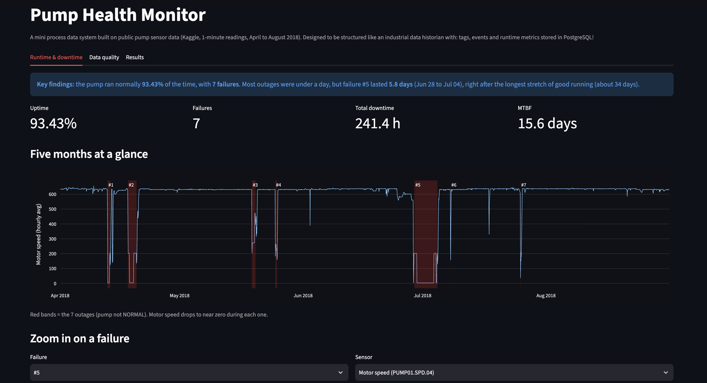
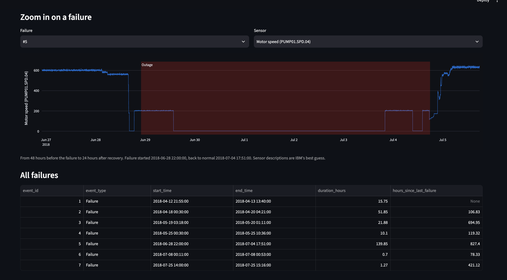
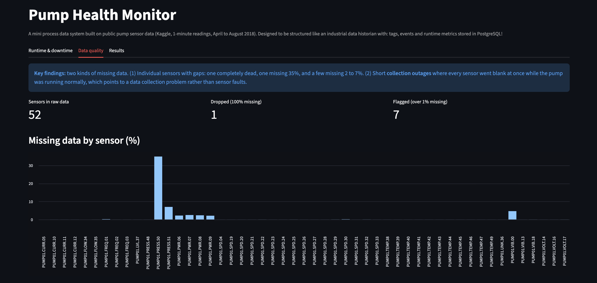
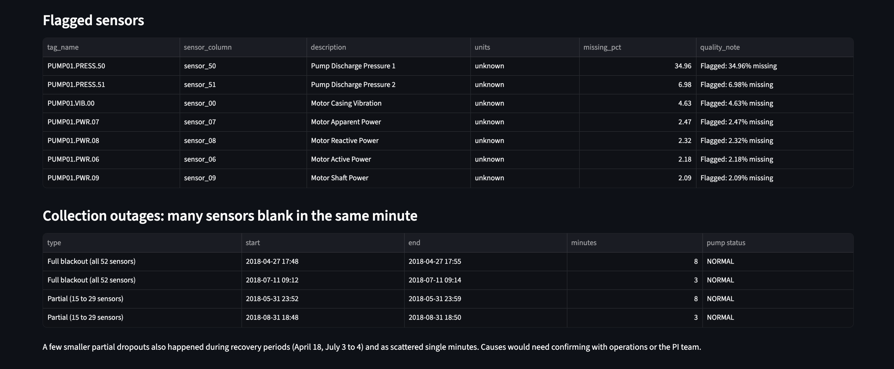

# Pump Health Monitor

A mini process data system built on public industrial pump sensor data. It takes raw 1-minute sensor readings, cleans them, organizes them the way an industrial data historian would (tags, events and runtime metrics), stores the results in PostgreSQL, and shows them in an interactive Streamlit dashboard.

## The challenge

Plants have years of sensor data, but raw readings alone don't answer the questions operations teams actually ask:

- How often does this equipment fail, and for how long?
- What is its uptime and mean time between failures (MTBF)?
- Which sensors can I trust, and where is the data itself unreliable?
- What did the sensors look like in the hours before a failure?

**Data requirements to answer them:**

- A clear, consistent naming scheme for each sensor (tags), with a quality note on each one
- A table of failure events with start time, end time and duration
- Repeatable runtime calculations (uptime, downtime, MTBF) defined once in SQL and saved as Views
- A way to separate equipment problems from data collection problems

## Key results

| Metric | Value |
|---|---|
| Period covered | April 1 to August 31, 2018 (3,672 hours) |
| Failures | 7 |
| Total downtime | 241.4 hours |
| Uptime | 93.43% |
| Average outage | 34.5 hours |
| Longest outage | 139.85 hours (about 5.8 days, June 28 to July 4) |
| MTBF | 374.66 hours (about 15.6 days) |

**Findings:**

- Most outages lasted under a day, but the longest one (almost 6 days) came right after the longest stretch of normal running (about 34 days).
- There are **two different kinds of missing data**:
  1. **Individual sensor gaps:** one sensor is completely empty, one is missing about 35%, and a few are missing 2 to 7%.
  2. **Collection outages:** short periods where every sensor went blank in the same minute (all 52 sensors) while the pump status was still NORMAL. That points to a data collection problem, not a pump or sensor fault.

## How a failure is defined

The dataset has a `machine_status` column with three values: `NORMAL`, `BROKEN` and `RECOVERING`. A failure event is any continuous stretch where the status is **not NORMAL**. It starts at the BROKEN reading and ends at the first minute the status returns to NORMAL, so recovery time counts as downtime.

## How it's built

The pipeline follows a bronze / silver / gold (medallion) layout:

| Layer | What it holds | Where |
|---|---|---|
| Bronze | Raw sensor CSV, untouched | `data/raw/sensor.csv` (not in repo) |
| Silver | Cleaned data, a tags table with quality notes, and a failure events table | `src/load_data.py`, `src/tags.py`, `src/events.py` → PostgreSQL |
| Gold | Business metrics: runtime summary, time between failures, MTBF | `sql/runtime_views.sql` (PostgreSQL views) |

```
Raw CSV → pandas cleaning → PostgreSQL tables (tags, events) → SQL views (uptime, MTBF) → Streamlit dashboard
```

### Data cleaning decisions

- **Dropped `sensor_15`:** 100% missing.
- **Flagged sensors over 1% missing:** labelled in the tags table, not filled in, and not used as main signals.
- **Kept all other sensors as-is:** the timeline was checked and every reading is exactly 1 minute apart.

### Tag naming

Each sensor gets a tag name in the format `PUMP01.<TYPE>.<NN>`, for example `PUMP01.SPD.04` for motor speed or `PUMP01.VIB.18` for pump casing vibration. This mirrors the dotted naming convention commonly used in industrial historians such as the AVEVA PI System.

### Runtime metrics in SQL

- **Uptime:** `1 - downtime / total hours`
- **Time between failures:** uses the `LAG()` window function to compare each failure's start with the previous failure's end
- **MTBF:** the average of those gaps

Defining these as SQL views means the logic lives in one place, and any tool that connects to the database gets the same numbers without having to do the actual calculation in the app itself.

## The dashboard

Three tabs:

1. **Runtime & downtime:** key findings, headline metrics (uptime, failures, downtime, MTBF), a 5-month motor speed timeline with each outage shaded in red, a sensor explorer that zooms into any failure (48 hours before to 24 hours after), and a table of all failures.




2. **Data quality:** missing data by sensor, the flagged sensors, and the collection outages where many sensors went blank at once.





3. **Honest results:** what I found, the limitations, what real plant data would add, and next steps.

## Project structure

```
pump-health-monitor/
├── app/
│   └── app.py                       # Streamlit dashboard
├── data/
│   └── raw/                         # sensor.csv goes here (not in repo)
├── notebooks/
│   └── 01_explore_and_quality.ipynb # exploration and data quality checks
├── reference/
│   └── ibm_sensor_labels.csv        # sensor descriptions and tag codes (generated with AI)
├── sql/
│   └── runtime_views.sql            # runtime_summary, time_between_failures, mtbf_summary all saved as views
├── src/
│   ├── db.py                        # PostgreSQL connection (SQLAlchemy engine)
│   ├── test_connection.py           # quick connection check
│   ├── load_data.py                 # load and clean the raw CSV
│   ├── tags.py                      # build the tags table
│   └── events.py                    # detect failure events
├── environment.yml
└── README.md
```

## How to run the project

**Requirements:** conda and PostgreSQL 16.

1. **Create the environment**
   ```bash
   conda env create -f environment.yml
   conda activate pump
   ```

2. **Get the data.** Download `sensor.csv` from [Kaggle](https://www.kaggle.com/datasets/nphantawee/pump-sensor-data) and place it in `data/raw/`.

3. **Create the database**
   ```bash
   createdb -U postgres pump_db
   ```
   The connection uses a `~/.pgpass` file for the password, so no passwords are stored in the code.

4. **Build the tables and views** (run from the project root)
   ```bash
   python src/tags.py
   python src/events.py
   psql -U postgres -d pump_db -f sql/runtime_views.sql
   ```

5. **Launch the dashboard**
   ```bash
   streamlit run app/app.py
   ```

## Limitations

- **Public dataset with anonymized sensors.** Sensor descriptions are a best guess, and units are unknown.
- **One pump, 5 months, 7 failures.** Too few events to make strong statistical claims.
- **1-minute resolution.** Anything shorter than a minute is invisible, wheras many industrial data historians store data to the second.
- **No maintenance records,** so the data can't show why the pump failed or what was repaired.

## Next steps

- **Readings table:** load the full sensor history into PostgreSQL in long format (tag, timestamp, value, quality), like a historian archive, so the dashboard reads everything from the database.
- **Early warning:** rolling robust z-scores to test how many hours before each failure a warning would appear.
- **More quality checks:** flatline (stuck sensor) and out-of-range checks.
- **Compression demo:** show how historian compression (swinging door) reduces stored data while keeping the shape of the signal.

## Data and credits

- **Data:** Pump Sensor Data, a public dataset shared on Kaggle by nphantawee (license listed as unknown). The raw data isn't included in this repo. Download it from Kaggle and place it in `data/raw/`.
- **Sensor descriptions:** based on the data dictionary from IBM's Maximo APM 8.7 lab, which uses this dataset: https://ibm.github.io/maximo-labs-archive/apm_8.7/data_dictionary. The descriptions are IBM's interpretation, not confirmed by the original data source. The reference file `reference/ibm_sensor_labels.csv` was put together with help from Claude.
- **AI assistance:** I built this project with help from Claude (Anthropic's AI assistant), which helped write the Python, SQL and Streamlit code. I set up the environment and database, ran and tested every step, went through the code line by line, and made the project decisions with it: how to handle missing data, how to define a failure, which metrics to calculate, and what to show on the dashboard.

## Tools

Python (pandas, SQLAlchemy, psycopg), PostgreSQL, SQL (CTEs, window functions, views), Streamlit, Plotly
